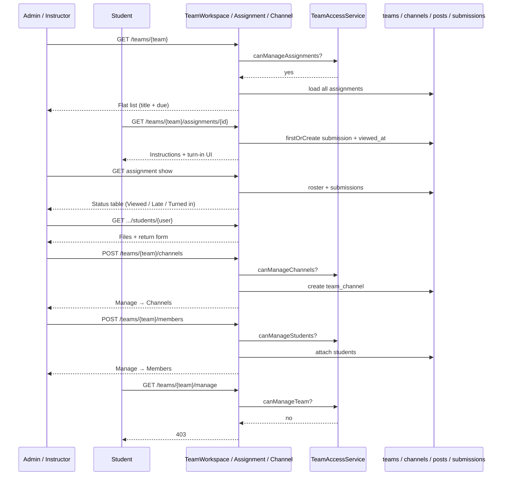

# Phase 4, Epic 4 — Teams Manage, Channels & Student Work UX

## Summary

Staff (admin / instructor on the team) see a flat assignment list (title + due only). Student work is a Teams-style status table (Turned in / Viewed / Late / etc.); clicking a row opens that student’s detail. Custom channels replace the single General feed. Manage team exposes only **Channels** and **Members** (staff only). Students cannot manage channels or members.

## Sequence

## Manual test checklist

1. **Staff assignment list**
   - As instructor on a team with 2 assignments: open Assignments.
   - Expect: no Upcoming / Past due / Completed tabs; each row shows title + due only.
   - As student on same team: tabs still appear.

2. **Viewed / Late / Turned in**
   - Student opens an assignment (do not turn in) → staff Student work table shows **Viewed**.
   - Past-due assignment, not turned in → **Late**.
   - Student turns in → **Turned in**; click row → see files; Return with feedback → **Returned**.

3. **Channels**
   - Manage team → Channels → Add channel “Algorithms”.
   - Sidebar lists General + Algorithms; posts on Algorithms stay on that channel.
   - Cannot delete General; can rename/delete custom channels.
   - Student sees channels and can reply; cannot open Manage team.

4. **Members**
   - Manage team → Members: searchable table; Add member modal; Remove student.
   - Student cannot attach/detach members (403).

5. **DB**
   - New team has one `team_channels` row (`is_general=1`, slug `general`).
   - `team_posts.team_channel_id` set on new posts.
   - Opening assignment as student sets `assignment_submissions.viewed_at`.
