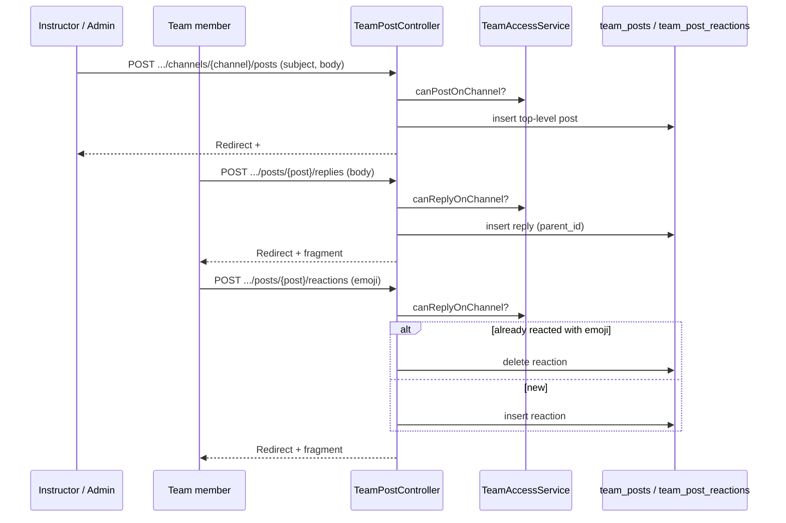

# Phase 4, Epic 5 — Channel posts (Teams-style) + reactions

## Summary

Channel feed matches Microsoft Teams Posts: **Start a post** composer (optional subject + Quill rich body + banner theme Auto/pick/none), colored **announcement header** when a subject is set, conversation cards with avatar / name / time, emoji **reactions on the top-right** of the post, flatter nested **replies** below a separator, and an inline reply bar. Staff can create top-level posts; all team members can reply and react.

## Sequence



## Manual test checklist

1. Open a channel as instructor → **Start a post** → subject + message → **Post**. Card shows subject headline, avatar, timestamp.
2. As student → reply via bottom bar (paper-plane). Reply appears under the post.
3. Click 😀 → pick 👍 / ❤️ → count badge appears; click again to remove.
4. Student cannot see **Start a post**; can still reply + react.
5. Non-member cannot view channel or react (403).

## DB checks

```sql
SELECT id, subject, parent_id, body FROM team_posts ORDER BY id DESC LIMIT 20;
SELECT * FROM team_post_reactions ORDER BY id DESC LIMIT 20;
```
